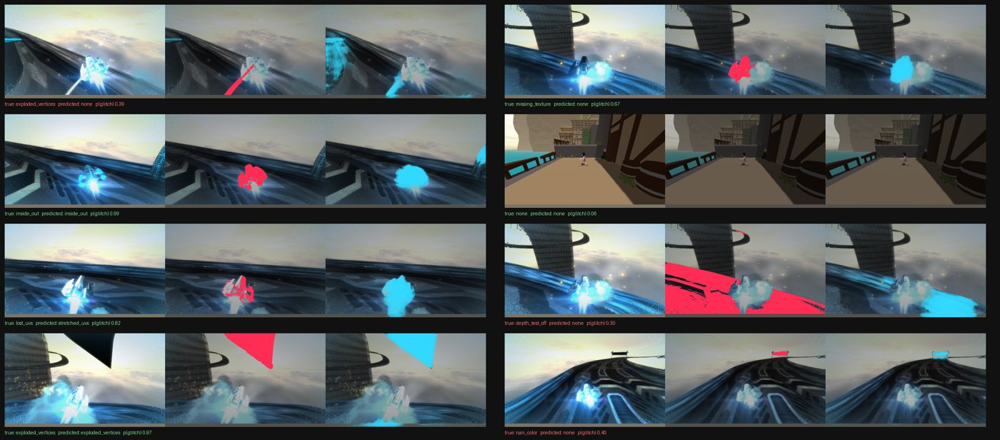

# framehound

Finds rendering glitches in screenshots of a WebGL game or app, after learning what that app looks like broken.

You point it at the app. It plays the app in headless Chrome, freezes it at moments along the way, and redraws each
frame with one draw call broken: a texture that never loaded, a part that never got drawn, garbage vertices, lost
texture coordinates and so on. The frame is drawn once clean and once broken, so the broken pixels are known exactly.
After about ten minutes of this it has around a thousand labelled frames of the app's own content, and trains a detector
on them. Then it checks new screenshots of the app.

It works with any WebGL engine and doesn't need the app's source: it wraps WebGL in the page.



*Frames from later in the play of two open-source games, which the model never trained on. Each row shows the frame, the
truly broken pixels (red) and what the model flagged (cyan). Rows with red text are misses.*

## Results

**On two real games.** Each game was played twice. The model learns from the first session and is tested on the
second, a separate play-through it never saw:

| Game | Test session | Glitch frames | Clean frames |
|---|---|---|---|
| [HexGL](https://github.com/BKcore/HexGL), a racing game | a new race on the same track | 487 | 150 |
| [Edelweiss](https://github.com/felixmariotto/Edelweiss), a platformer | a new walk from the same start | 198 | 111 |

The best training epoch is picked on a held-out slice of the first session, so the test session is only used for the
final score.

| AUROC on the test session (0.5 = chance) | Never saw the game | 2.5 min of play | 5 min | 10 min |
|---|---|---|---|---|
| HexGL | 0.55 | 0.78 | 0.81 | **0.90** (95% CI 0.88–0.93) |
| Edelweiss | 0.54 | 0.89 | **0.95** (0.93–0.98) | 0.94 (0.91–0.97) |

| Glitches caught when 5% of clean frames are flagged | 2.5 min | 5 min | 10 min |
|---|---|---|---|
| HexGL | 18% | 24% | **70%** |
| Edelweiss | 71% | **88%** | 58% |

HexGL keeps improving with more play: a race shows a lot of different track, and ten minutes hasn't levelled off yet.
Edelweiss levels off by five minutes. Its test walk starts in the same village as the training walk, which makes it
an easier test. The difference between its 5- and 10-minute models is within the spread between training runs.

With ten minutes of HexGL, at that setting it catches:
- 92% of lost texture coordinates
- 89% of missing textures
- 80% of NaN colours

It catches fewer than half of exploded vertices and inside-out meshes.

**On three.js examples** the same holds: on five pages never trained on, a model trained on 145 other pages scores 0.67;
models trained on each page's own earlier frames score 0.89–0.93.

**What doesn't work: one model for every app.** framehound started as a single model meant to spot glitches in any
game's screenshot. It doesn't get there:

| One model for every app | AUROC |
|---|---|
| Trained on 145 three.js examples, tested on 27 others | 0.62 |
| Trained on synthetic scenes, tested on real game screenshots ([VideoGameQA-Bench](https://huggingface.co/datasets/taesiri/VideoGameQA-Bench), rendering glitches vs clean frames) | about 0.5 |

Many glitches only look wrong if you know what the app is meant to look like. A missing wall, an object drawn through
another, a glowing surface or an inside-out mesh can all be intended in some other app. Published work that does
well gets around this the same way framehound now does: EA SEED trained per game environment, and NetEase injected
bugs into each game it tested.

**Caveats.**
- The test glitches are injected, not taken from the games' bug histories. They are real failure modes of real
  renderers, but they are ours.
- Each result is one training run; two runs on the same data can differ by a few points.
- HexGL's laps revisit the same track. That's fair for a tool that learns one game, but easier than a game whose
  content never repeats.

## Use it

Needs Node 18+, Google Chrome, and Python 3.10+ with PyTorch.

```bash
npm install
python3 -m venv .venv && .venv/bin/pip install -r train/requirements.txt

# learn an app: about 10 minutes of play, then training (~20 min on an Apple M-series GPU)
node framehound.mjs learn https://example.com/my-webgl-app/ --minutes 10

# check screenshots: a verdict, a glitch score, the likely kind of glitch, and a heatmap image
node framehound.mjs check models/my-webgl-app shot1.png shot2.png
```

`learn` writes `models/<app>/`:
- `model.pt`
- `report.json`: how it did on the held-out later views, and the score threshold that flags 5% of clean frames, which
  `check` uses
- `examples.png`: a sheet like the one above

Pages on disk can be served with `--serve folder` and a url starting with `/`.

**Games need a driver**, a small script that gets past the menus and plays between moments. Without one, framehound just
drags the camera a little. These are the drivers used above:

```js
// generator/apps/drivers/hexgl.mjs (shortened)
export async function start(page) {
  await page.click('#start');
  await page.click('#step-2');
  await page.waitForFunction(() => document.getElementById('step-4')?.style.display === 'block');
  await page.keyboard.down('ArrowUp'); // full throttle
}
export async function between(page, gap) {
  /* steer left and right at random for `gap` seconds */
}
```

```bash
node framehound.mjs learn '/HexGL/index.html?controlType=0&hud=0&godmode=1' --id hexgl --serve sources \
  --driver generator/apps/drivers/hexgl.mjs
```

## How it works

`generator/inject/glitch-gl.js` is loaded into the page before the page's own scripts:

- **Freezes the page.** It controls `performance.now`, `Date`, `Math.random` and `requestAnimationFrame`. Time spent
  frozen is taken out afterwards, so the game behaves as if paused.
- **Records one frame.** Every WebGL call in one frame is recorded, with copies of the arrays and images passed in.
- **Replays it, broken.** The recorded frame is replayed with one draw call broken, and every bit of GL state the glitch
  touched is put back. A replay holds the frame still even when the app moves things a fixed amount each frame. It's
  used only when two replays match each other and the app's own frame; otherwise the injector steps the app's own frame
  loop until the frame stops changing.
- **Keeps only visible glitches.** A glitch counts only if at least 0.1% of the frame changes plainly, in one connected
  patch, and the frame doesn't go blank. Faint changes such as a bloom halo, or a black frame, which looks like a clean
  empty scene, are thrown away.

The ten kinds of breakage:

| Glitch | What happens to the draw |
|---|---|
| `missing_texture` | its base texture is swapped for a fallback: magenta/black checker, flat magenta, black, white or grey checker |
| `missing_draw` | it never happens: a missing wall, a body without a head |
| `exploded_vertices` | a few vertices get garbage positions and drag spikes across the frame |
| `broken_indices` | its index data is corrupted, so triangles join the wrong vertices |
| `lost_uvs` | its texture coordinates are lost and the surface takes one texel's colour |
| `stretched_uvs` | its texture coordinates are squashed and the texture smears |
| `inside_out` | culling is flipped and the inside shows |
| `depth_test_off` | it draws over whatever should hide it |
| `additive_blend` | a leaked blend mode makes it glow and turn see-through |
| `nan_color` | its material colour becomes NaN or zero, so it goes black (and NaNs can spread through post effects) |

On WebGL 1, which can't read buffers back, the injector keeps a copy of each buffer as the app uploads it. Tested on
three.js from r53 to r170.

The model is a U-Net with a ResNet-34 encoder and a glitch-type head (`train/`). It predicts both whether a frame is
broken and which pixels.

## In this repository

| Path | What it is |
|---|---|
| `framehound.mjs` | the `learn` and `check` commands |
| `generator/inject/glitch-gl.js` | the injector |
| `generator/capture.mjs` | drives pages with the injector and saves clean frames, broken frames and masks |
| `generator/apps/` | page lists and game drivers |
| `train/` | training (`train.py`), checking screenshots (`check.py`) and the evaluations |
| `scripts/` | fetching test data, filtering and splitting captured data |
| `generator/run.mjs`, `generator/scene.js` | the first approach: random three.js scenes built from Poly Haven models, broken in seven ways |
| `labels/videogameqa.json` | which VideoGameQA-Bench glitch screenshots show rendering glitches (first pass, not yet checked by hand) |

## Credits

- [HexGL](https://github.com/BKcore/HexGL) by Thibaut Despoulain (MIT).
- [Edelweiss](https://github.com/felixmariotto/Edelweiss) by Félix Mariotto (CC0).
- The three.js examples (MIT).
- 3D models and HDRIs for the scene generator: [Poly Haven](https://polyhaven.com) (CC0).
- Test sets:
  - [VideoGameQA-Bench](https://huggingface.co/datasets/taesiri/VideoGameQA-Bench) (Taesiri et al., CC BY 4.0)
  - [GlitchBench](https://arxiv.org/abs/2312.05291)
  - three.js's own reference screenshots

## License

Code: MIT. Games and assets keep their own licenses.
