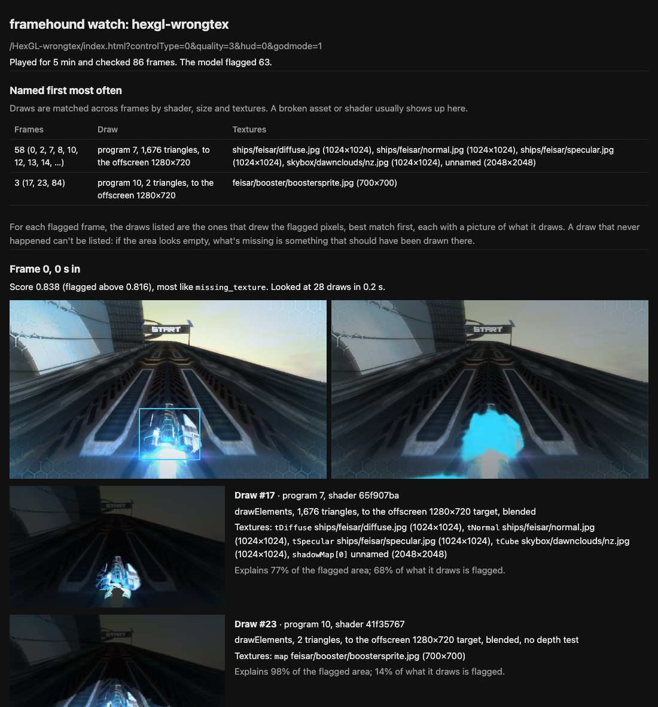

# framehound

Finds rendering glitches in a WebGL game or app after learning what that app looks like broken, and points to the
draw call that drew them.

You point it at the app. It plays the app in headless Chrome, freezes it at moments along the way, and redraws each
frame with one draw call broken: a texture that never loaded, a part that never got drawn, garbage vertices, lost
texture coordinates and so on. The frame is drawn once clean and once broken, so the broken pixels are known exactly.
After about ten minutes of this it has around a thousand labelled frames of the app's own content, and trains a detector
on them.

Then it watches new builds. `framehound watch` plays a build the same way and checks every frame it stops on. For each
frame the model flags, it finds the draw calls behind the flagged pixels, by drawing the frame again with each draw
left out. It writes a report listing each one's shader, textures and size, with a picture of what it draws. It can
also check plain screenshots.

It doesn't need the app's source: it wraps WebGL in the page. There is also a Vulkan version of the injector for
native apps, in [`native/`](native/).


*Frames from later in the play of two open-source games, which the model never trained on. Each row shows the frame, the
truly broken pixels (red) and what the model flagged (cyan). Rows with red text are misses.*

## Results

**On two real games.** Each game was played twice. The model learns from the first session and is tested on the
second, a separate play-through it never saw:

| Game | Test session | Glitch frames | Clean frames |
|---|---|---|---|
| [HexGL](https://github.com/BKcore/HexGL), a racing game | a new race on the same track | 487 | 150 |
| [Edelweiss](https://github.com/felixmariotto/Edelweiss), a platformer | a new walk from the same start | 198 | 111 |

The best training epoch is picked on a held-out slice of the first session, so the test session is only used for the
final score.

| AUROC on the test session (0.5 = chance) | Never saw the game | 2.5 min of play | 5 min | 10 min |
|---|---|---|---|---|
| HexGL | 0.55 | 0.78 | 0.81 | **0.90** (95% CI 0.88–0.93) |
| Edelweiss | 0.54 | 0.89 | **0.95** (0.93–0.98) | 0.94 (0.91–0.97) |

| Glitches caught when 5% of clean frames are flagged | 2.5 min | 5 min | 10 min |
|---|---|---|---|
| HexGL | 18% | 24% | **70%** |
| Edelweiss | 71% | **88%** | 58% |

HexGL keeps improving with more play: a race shows a lot of different track, and ten minutes hasn't levelled off yet.
Edelweiss levels off by five minutes. Its test walk starts in the same village as the training walk, which makes it
an easier test. The difference between its 5- and 10-minute models is within the spread between training runs.

With ten minutes of HexGL, at that setting it catches:
- 92% of lost texture coordinates
- 89% of missing textures
- 80% of NaN colours

It catches fewer than half of exploded vertices and inside-out meshes.

**On three.js examples** the same holds: on five pages never trained on, a model trained on 145 other pages scores 0.67;
models trained on each page's own earlier frames score 0.89–0.93.

**On real bugs.** These are rendering bugs that three.js actually shipped, each learned on the example's last good release
and tested on 30 frames from the broken release against 30 from the release that fixed it:

| Bug | Learned on | AUROC, broken vs fixed | Broken frames flagged | Fixed frames flagged |
|---|---|---|---|---|
| [#27809](https://github.com/mrdoob/three.js/issues/27809): a shader error turns the progressive-lightmap scene black (r161) | r160 | **1.00** | 30 of 30 | 0 of 30 |
| [#30819](https://github.com/mrdoob/three.js/issues/30819): extruded shapes lose their end caps (r175), learned on one page load | r174 | 0.52 (chance) | 30 of 30 | 24 of 30 |
| the same, learned across 30 page loads (`--reload-every 3`) | r174 | 0.48 (chance) | 0 of 30 | 4 of 30 |
| the same, also learning from meshes with missing faces (`dropped_faces`) | r174 | 0.52 (chance) | 0 of 30 | 3 of 30 |

The flags use the model's own threshold, set when learning on injected glitches. The first bug is caught on every
frame, with the black objects outlined.

The second is missed:
- **One page load wasn't enough.** The example builds a new random shape every time the page loads. Learned from a
  single load, the model flagged most frames of any new load, fixed release included. Learned across many loads, it
  stops doing that.
- **A matching glitch didn't help.** Adding a glitch that removes some of a mesh's faces didn't change the result,
  though the model catches that injected glitch every time.
- **The bug is too small.** Rendering both releases with the same random shape shows that the missing cap covers 687
  pixels of a 1280×720 frame, 0.075% of it. That's about a third of the smallest glitch framehound learns from (0.2%
  of the frame, the floor that keeps out changes nobody would see). It's below what framehound can notice.

Two more cases were left out:
- [#26112](https://github.com/mrdoob/three.js/issues/26112), the car example: no difference shows in headless Chrome.
- [#26110](https://github.com/mrdoob/three.js/issues/26110), the SVG example: it only draws when the mouse moves,
  which the injector can't freeze yet.

**Watch mode.** Two builds with a real kind of bug:
- **A broken three.js release.** Watching the r161 progressive-lightmap example, with the model learned on r160,
  every frame is flagged. The first two draws named are the ground and the object, both drawn with the broken
  lightmap shader (they sample the 1024×1024 lightmap). Finding them takes 0.2 s per frame.
- **A wrong asset.** In a copy of HexGL, the ship's texture file holds the track's texture instead, as if the wrong
  file had shipped. The model learned on the right build flags 59 of 77 frames, against about 7% of frames on the
  right build. The report's top table names the same draw first in 41 of them: 1,676 triangles sampling
  `ships/feisar/diffuse.jpg`, the file to check.



To measure naming, watch played HexGL four times for 12 minutes and broke a known draw on about half the frames
(`--plant 0.5`). Over the four runs, the model flagged 281 of 372 broken frames (76%) and 24 of 351 clean ones
(7%). For the 79 flagged frames of the last run, this is how often the broken draw came first:

| Broken draw | Frames | Named first | In the top three |
|---|---|---|---|
| a draw to the frame itself | 41 | **73%** | 80% |
| the same, ranked by the truly broken pixels instead of the model's heatmap | 41 | 90% | 95% |
| a draw to a shadow map or another offscreen target | 18 | 0% | 22% |
| a draw that was left out | 20 | can't be named | |

- **Offscreen draws.** A draw into a shadow map only shows through the surfaces that receive the shadow. Leaving it out
  changes those surfaces more than the glitch did, so it is rarely pinned down.
- **Draws that were left out** never drew anything, so there's nothing to name.
- **The heatmap's cost.** Where the model points loses 17 points against the truly broken pixels, so a better heatmap
  means better naming. A plain box around the flagged area does worse still: 34% first, against 51% with the heatmap
  on the same frames.

**The Vulkan layer** (`native/`) breaks draw calls in native Vulkan apps the same way, in six of the eleven ways so
far. On a small Vulkan test scene it wrote 825 visible broken frames from 140 captured frames in about ten seconds,
where the browser takes minutes. A model trained on the first 80% of those frames scores AUROC 0.93 on the rest. The
Khronos validation layer finds no errors added by the layer. It also runs on vkcube, Khronos's Vulkan sample, in a
real window, though vkcube records its command buffers once and reuses them. It also works on GFXReconstruct
replays, which come out pixel for pixel like the live run, so a session recorded once can be broken again and again
without the app. See [native/README.md](native/README.md).

**What doesn't work: one model for every app.** framehound started as a single model meant to spot glitches in any
game's screenshot. It doesn't get there:

| One model for every app | AUROC |
|---|---|
| Trained on 145 three.js examples, tested on 27 others | 0.62 |
| Trained on synthetic scenes, tested on real game screenshots ([VideoGameQA-Bench](https://huggingface.co/datasets/taesiri/VideoGameQA-Bench), rendering glitches vs clean frames) | about 0.5 |

Many glitches only look wrong if you know what the app is meant to look like. A missing wall, an object drawn through
another, a glowing surface or an inside-out mesh can all be intended in some other app. Published work that does
well gets around this the same way framehound now does: EA SEED trained per game environment, and NetEase injected
bugs into each game it tested.

**Limits.**
- **One app at a time.** A model knows one app. A new app needs its own ten minutes of play and about twenty of
  training, since one model for every app doesn't work (above).
- **Glitches you can see at a glance.** Glitches smaller than about 0.2% of the frame are missed. The missing caps
  above covered 0.075%.
- **Single frames.** Flicker, popping, and anything that only looks wrong over time are out of reach. So are animation
  and physics bugs: a character in the wrong pose still looks like a pose.
- **A draw that never happened can't be named.** Watch lists the draws that drew the flagged area. For a missing
  draw, those are whatever was behind it.
- **Pages that draw only on input** can't be frozen yet. The three.js SVG example draws only when the mouse moves.
- **Tested on three.js.** HexGL, Edelweiss and the examples are all three.js apps. The injector wraps WebGL itself,
  but other engines haven't been tried.

**Caveats.**
- The test glitches are injected, not taken from the games' bug histories. They are real failure modes of real
  renderers, but they are ours.
- Each result is one training run; two runs on the same data can differ by a few points.
- HexGL's laps revisit the same track. That's fair for a tool that learns one game, but easier than a game whose
  content never repeats.

## Use it

Needs Node 18+, Google Chrome, and Python 3.10+ with PyTorch.

```bash
npm install
python3 -m venv .venv && .venv/bin/pip install -r train/requirements.txt

# learn an app: about 10 minutes of play, then training (~20 min on an Apple M-series GPU)
node framehound.mjs learn https://example.com/my-webgl-app/ --minutes 10

# watch a new build: play it for 5 minutes, check every frame, and name the draw calls behind each flagged one
node framehound.mjs watch models/my-webgl-app https://example.com/my-webgl-app-new-build/ --minutes 5

# check screenshots: a verdict, a glitch score, the likely kind of glitch, and a heatmap image
node framehound.mjs check models/my-webgl-app shot1.png shot2.png
```

`watch` writes `watch/<app>-<time>/report.html`. At the top, a table lists the draws named first most often, matched
across frames by shader, size and textures, since a broken asset or shader shows up in many frames. Each flagged frame
shows the frame with the flagged area boxed, the heatmap, and the draws found there, best match first. Each draw comes with a picture of what it draws, its shader
(three.js names its shaders), the textures it samples with their file names, its triangle count, and whether it
draws to the screen or to an offscreen target such as a shadow map. `--plant 0.5` tests watch itself: it breaks a known
draw on half the frames and reports how many were caught and named.

`learn` writes `models/<app>/`:
- `model.pt`
- `report.json`: how it did on the held-out later views, and the score threshold that flags 5% of clean frames, which
  `check` uses
- `examples.png`: a sheet like the one above

Pages on disk can be served with `--serve folder` and a url starting with `/`.

**Games need a driver**, a small script that gets past the menus and plays between moments. Without one, framehound just
drags the camera a little. These are the drivers used above:

```js
// generator/apps/drivers/hexgl.mjs (shortened)
export async function start(page) {
  await page.click('#start');
  await page.click('#step-2');
  await page.waitForFunction(() => document.getElementById('step-4')?.style.display === 'block');
  await page.keyboard.down('ArrowUp'); // full throttle
}
export async function between(page, gap) {
  /* steer left and right at random for `gap` seconds */
}
```

```bash
node framehound.mjs learn '/HexGL/index.html?controlType=0&hud=0&godmode=1' --id hexgl --serve sources \
  --driver generator/apps/drivers/hexgl.mjs
```

## How it works

`generator/inject/glitch-gl.js` is loaded into the page before the page's own scripts:

- **Freezes the page.** It controls `performance.now`, `Date`, `Math.random` and `requestAnimationFrame`. Time spent
  frozen is taken out afterwards, so the game behaves as if paused.
- **Records one frame.** Every WebGL call in one frame is recorded, with copies of the arrays and images passed in.
- **Replays it, broken.** The recorded frame is replayed with one draw call broken, and every bit of GL state the glitch
  touched is put back. A replay holds the frame still even when the app moves things a fixed amount each frame. It's
  used only when two replays match each other and the app's own frame; otherwise the injector steps the app's own frame
  loop until the frame stops changing.
- **Keeps only visible glitches.** A glitch counts only if at least 0.1% of the frame changes plainly, in one connected
  patch, and the frame doesn't go blank. Faint changes such as a bloom halo, or a black frame, which looks like a clean
  empty scene, are thrown away.
- **Finds the draws behind a flagged area (watch).** The frozen frame is drawn again once per draw call with that draw
  left out, and the pixels that change are that draw's. Draws are ranked by how much of the model's heatmap they
  explain times how much of what they draw is flagged. That puts the object itself ahead of the ground behind it.
  Draws that only reach the frame through a later pass count half: draws into shadow maps and other offscreen targets
  of another size, and full-screen passes. A replayed frame takes 0.1–0.4 s for all of HexGL's ~30 draws.

The eleven kinds of breakage:

| Glitch | What happens to the draw |
|---|---|
| `missing_texture` | its base texture is swapped for a fallback: magenta/black checker, flat magenta, black, white or grey checker |
| `missing_draw` | it never happens: a missing wall, a body without a head |
| `exploded_vertices` | a few vertices get garbage positions and drag spikes across the frame |
| `broken_indices` | its index data is corrupted, so triangles join the wrong vertices |
| `dropped_faces` | some of its triangles are never drawn: holes, missing caps, see-through patches |
| `lost_uvs` | its texture coordinates are lost and the surface takes one texel's colour |
| `stretched_uvs` | its texture coordinates are squashed and the texture smears |
| `inside_out` | culling is flipped and the inside shows |
| `depth_test_off` | it draws over whatever should hide it |
| `additive_blend` | a leaked blend mode makes it glow and turn see-through |
| `nan_color` | its material colour becomes NaN or zero, so it goes black (and NaNs can spread through post effects) |

On WebGL 1, which can't read buffers back, the injector keeps a copy of each buffer as the app uploads it. Tested on
three.js from r53 to r170.

The model is a U-Net with a ResNet-34 encoder and a glitch-type head (`train/`). It predicts both whether a frame is
broken and which pixels.

## In this repository

| Path | What it is |
|---|---|
| `framehound.mjs` | the `learn`, `watch` and `check` commands |
| `generator/inject/glitch-gl.js` | the injector |
| `generator/capture.mjs` | drives pages with the injector and saves clean frames, broken frames and masks |
| `generator/watch.mjs` | plays a build, checks each frame with the model, finds the draws behind flagged frames, writes the report |
| `generator/serve.mjs` | the static server for pages on disk |
| `native/` | the Vulkan layer (C++) and a test scene |
| `generator/apps/` | page lists and game drivers |
| `train/` | training (`train.py`), checking screenshots (`check.py`) and the evaluations |
| `scripts/` | fetching test data, filtering and splitting captured data |
| `generator/run.mjs`, `generator/scene.js` | the first approach: random three.js scenes built from Poly Haven models, broken in seven ways |
| `labels/videogameqa.json` | which VideoGameQA-Bench glitch screenshots show rendering glitches (first pass, not yet checked by hand) |

## Credits

- [HexGL](https://github.com/BKcore/HexGL) by Thibaut Despoulain (MIT).
- [Edelweiss](https://github.com/felixmariotto/Edelweiss) by Félix Mariotto (CC0).
- The three.js examples (MIT).
- 3D models and HDRIs for the scene generator: [Poly Haven](https://polyhaven.com) (CC0).
- Test sets:
  - [VideoGameQA-Bench](https://huggingface.co/datasets/taesiri/VideoGameQA-Bench) (Taesiri et al., CC BY 4.0)
  - [GlitchBench](https://arxiv.org/abs/2312.05291)
  - three.js's own reference screenshots

## License

Code: MIT. Games and assets keep their own licenses.
