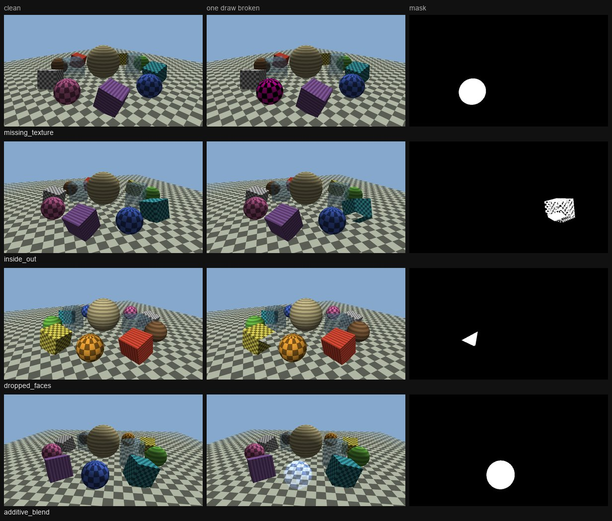
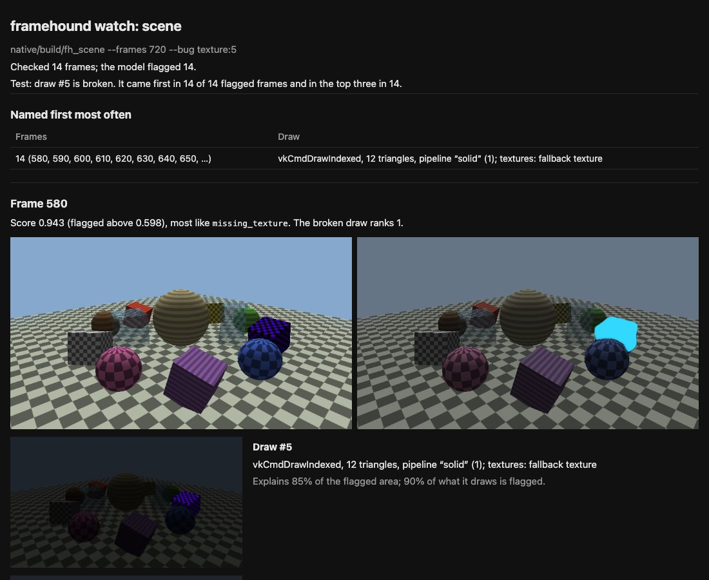
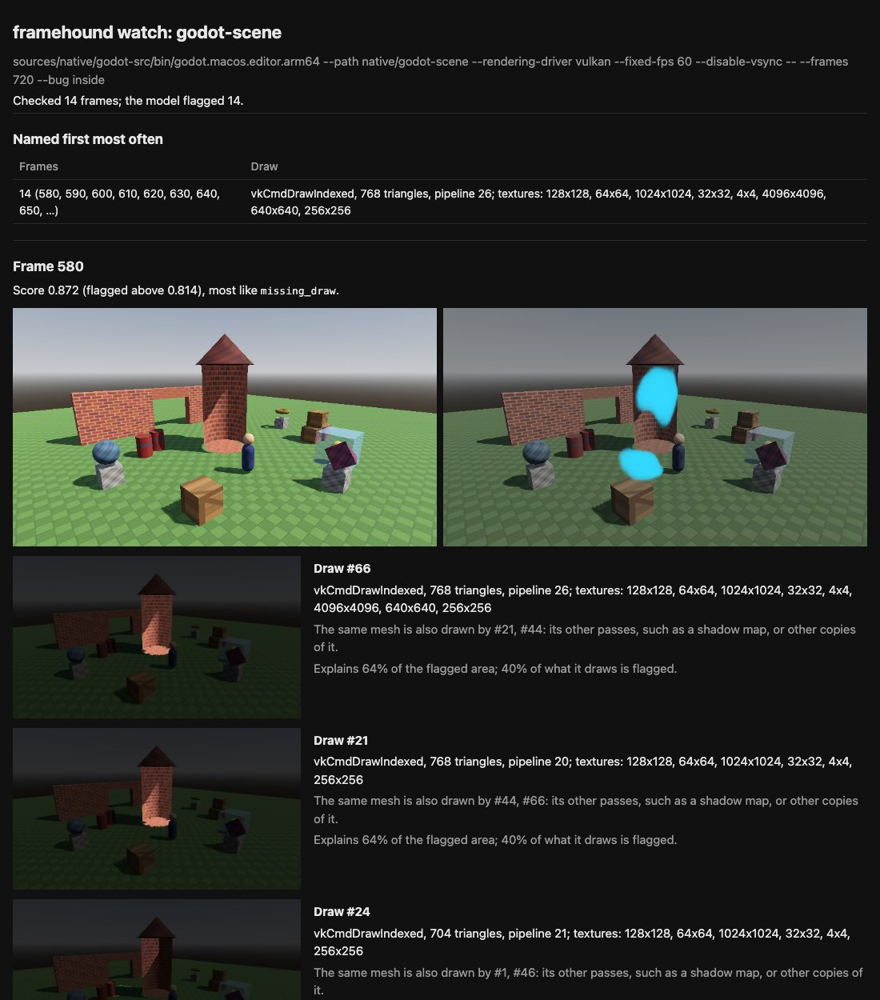

# framehound's Vulkan layer

[](https://github.com/aarxa/framehound/actions/workflows/native.yml)

This is the native version of the WebGL injector, `generator/inject/glitch-gl.js`. It's a Vulkan layer that the
Vulkan loader puts into any Vulkan app. It writes the app's own frames twice, once clean and once with one draw call
broken, along with the exact mask of the broken pixels. The output has the same layout as the WebGL capture, so
`scripts/split_same_page.py`, `train/train.py` and the evaluations read it unchanged.



## How it works

The WebGL injector freezes the page's clock and replays the recorded frame, so it can draw the frame twice. A layer
can't freeze a native app's clock, so this one draws the frame twice another way:

- **Shadow recording.** On a capture frame, every command the app records goes into its own command buffer and also
  into a few shadow copies. Each copy breaks one draw call. The layer has wrappers for all 307 recording commands,
  generated from the Vulkan registry (`layer/gen_commands.py`), so no command goes missing from a copy.
- **The whole frame again, once per copy.** The app's submits go through untouched. Just before the frame is
  presented, the layer reads it back, then submits the frame's command buffers again with each shadow copy swapped in,
  and reads each result. A clean copy runs last, so the frame presented is the app's own. Engines often draw one frame
  in several submits: Godot draws the scene into its own images, then copies the result to the window in a second
  submit. So nothing is read back until the whole frame is in. The app has already written that frame's data
  (matrices, animation, uniforms), so the clean and broken frames differ only by what was broken.
- **Whole meshes.** Engines draw each mesh several times a frame: into a shadow map, into a depth pre-pass, then in
  colour. A real bug, such as a broken asset, shows in all of those, so a glitch breaks every draw of the same mesh,
  told apart by the index or vertex data it reads. Breaking only one of them looks like no real bug: on Godot, a mesh
  left out of its colour pass but not its depth pre-pass draws as a black hole, not a missing object. A mesh drawn in
  many places is broken in all of them, as a broken asset would be.
- **Draws that show.** Breaking a draw that writes into a buffer nothing displays changes nothing, and engines have
  many such draws. The layer counts, per pipeline, how often breaking a draw changed the frame, and picks draws from
  pipelines that show more often, while still trying the others.
- **Pipeline variants.** Glitches that change render state (culling, depth test, blending) need different pipelines.
  The layer creates those variants inside `vkCreateGraphicsPipelines`, while the app's create info is still at hand,
  and binds them for the broken draw only.
- **Copied descriptor sets.** For a missing texture, the broken draw gets a copy of one of its descriptor sets, with
  one sampled image swapped for a fallback texture. The image swapped holds an asset: the app never draws into it (so
  it isn't a shadow map or a render target), and it's bigger than 8×8 (so it isn't a default texture).
- **Same rules as the WebGL side.** A broken frame is kept only if the glitch is visible:
  - 0.2–60% of the frame changes;
  - at least 0.1% of the frame changes plainly, in a patch of at least 150 px (at 768×432);
  - the frame doesn't go blank.

The six glitches so far:

| Glitch | What happens to the draw |
|---|---|
| `missing_draw` | it never happens |
| `missing_texture` | one of its textures is swapped for a fallback: magenta/black checker, black or grey checker |
| `dropped_faces` | a run of its triangles is skipped, leaving a hole |
| `inside_out` | culling is flipped and the inside shows |
| `depth_test_off` | it draws over whatever should hide it |
| `additive_blend` | it's blended additively, so it glows and turns see-through |

## Build and run

You need CMake, a C++17 compiler, the Vulkan loader and headers, and glslang. On a Mac, MoltenVK and the rest come
from Homebrew:

```bash
brew install molten-vk vulkan-loader vulkan-headers vulkan-tools glslang cmake
cmake -S native -B native/build -DCMAKE_BUILD_TYPE=Release && cmake --build native/build
```

On Linux, the distribution's Vulkan headers, loader and glslang, plus zlib, are enough. Every push that touches
`native/` builds the layer on Ubuntu 24.04 and runs `native/check.sh` on Mesa's software Vulkan driver (lavapipe):
capture in each of the scene's modes, under the Khronos validation layer. On Windows, the Vulkan SDK should do, but
it hasn't been tried. The build writes the layer's manifest next to the library, with the library's name on that
platform.

Run any Vulkan app with the layer on:

```bash
FRAMEHOUND_OUT=data/native-scene FRAMEHOUND_APP=scene FRAMEHOUND_START=10 FRAMEHOUND_EVERY=5 \
  FRAMEHOUND_CAPTURES=140 FRAMEHOUND_VARIANTS=10 \
  VK_ADD_LAYER_PATH=native/build VK_INSTANCE_LAYERS=VK_LAYER_FRAMEHOUND_glitch \
  native/build/fh_scene --frames 720
```

Then learn from it as from any capture:

```bash
.venv/bin/python -I scripts/split_same_page.py data/native-scene data/native-scene-split --last-share 0.2
.venv/bin/python train/train.py --data data/native-scene-split --out runs/native-scene --epochs 15
```

`framehound.mjs` does all of that in one step, and runs `locate.py` (below) for watch:

```bash
node framehound.mjs learn-native --id scene --every 5 --captures 140 -- native/build/fh_scene --frames 720
node framehound.mjs watch-native models/scene --start 580 --every 10 --count 14 -- \
  native/build/fh_scene --frames 720 --bug texture:5
```

| Setting | Meaning |
|---|---|
| `FRAMEHOUND_OUT` | folder to write to; without it the layer passes everything through |
| `FRAMEHOUND_APP` | the app's id in the manifest |
| `FRAMEHOUND_START`, `FRAMEHOUND_EVERY` | first frame to capture, then every N frames |
| `FRAMEHOUND_CAPTURES` | the most frames to capture |
| `FRAMEHOUND_VARIANTS` | broken copies per captured frame; 0 keeps clean frames only |
| `FRAMEHOUND_TYPES` | glitches to use, comma-separated |
| `FRAMEHOUND_SHADOW_ALL=1` | shadow every command buffer, for apps that record theirs once and submit them every frame |
| `FRAMEHOUND_SEED` | random seed |
| `FRAMEHOUND_LOCATE` | frames to draw again once per draw, each without one draw (see below); replaces the schedule |
| `FRAMEHOUND_TRACE=1` | log how the frames around the first capture are laid out (command buffers, submits, presents) and how much each broken copy changed |

`fh_scene` (`testapp/`) is a small Vulkan scene for trying the layer without a game. It draws a textured ground, a ring
of turning cubes and spheres, and two glass boxes, to a headless swapchain (no window). Like a game engine, it
re-records its command buffer every frame. Options try the layer on what engines do differently:
- `--indirect` draws everything with `vkCmdDrawIndexedIndirect`, and `--indirect-count` with
  `vkCmdDrawIndexedIndirectCount` (MoltenVK doesn't support it, so it's tested on Linux);
- `--secondary` records the draws in a secondary command buffer;
- `--submit2` submits with `vkQueueSubmit2`;
- `--timeline` also signals a timeline semaphore every frame;
- `--bug texture:N` or `--bug inside:N` ships a bug in draw N, for testing `locate.py`.

It names its pipelines and textures with `VK_EXT_debug_utils`, as engines do.

## Naming the draws behind a flagged frame

`native/locate.py` is `framehound watch` for Vulkan apps. It runs the app twice with the layer:
1. The first run keeps every Nth frame (`FRAMEHOUND_VARIANTS=0`), and the app's model checks them.
2. The second run draws each flagged frame once per draw call with that draw left out (`FRAMEHOUND_LOCATE`). Draws
   are ranked by the model's heatmap, as in the WebGL watch.

The report describes each draw by its call, size, pipeline and the textures it samples. The layer follows the draw's
descriptor sets to their image views and images. It names things by what the app called them with `VK_EXT_debug_utils`,
as engines do in their development builds, or by size when they're unnamed. Descriptor sets written with update
templates aren't followed yet. Each draw lists the other draws of the same mesh, so a draw into a shadow map can be
tied to the object it belongs to.

```bash
.venv/bin/python native/locate.py --model models/native-scene --out watch/native-bug --start 580 --every 10 --count 14 \
  --expect 5 -- native/build/fh_scene --frames 720 --bug texture:5
```



Both runs must draw the same frames. A deterministic app does, and so does a replay of a recording (below). The
report checks that they did.

To test it, `fh_scene --bug` ships a bug in one draw. The model learned on the clean scene checked 14 frames from the
stretch of the camera's path it never trained on:

| Build | Frames flagged | Broken draw named first |
|---|---|---|
| no bug | 2 of 14 | |
| a cube drawn with the fallback texture (`--bug texture:5`) | 14 of 14 | 14 of 14 |
| the big sphere drawn with the fallback texture (`texture:11`) | 14 of 14 | 14 of 14 |
| the big sphere drawn inside out (`inside:11`) | 14 of 14 | 14 of 14 |
| a cube drawn inside out (`inside:3`) | 2 of 14 | 0 of 2 |

The inside-out cube is missed. The model catches only 64% of inside-out glitches in its own tests, and a small cube
seen from inside looks much like a cube.

## Recorded sessions

The layer also works on replays from [GFXReconstruct](https://github.com/LunarG/gfxreconstruct), LunarG's capture
and replay tool, which ships with the Vulkan SDK. A session recorded once can be broken as many times as wanted,
without the app:

```bash
# record 120 frames of the app (any Vulkan app; the GFXReconstruct layer comes with the SDK)
VK_INSTANCE_LAYERS=VK_LAYER_LUNARG_gfxreconstruct GFXRECON_CAPTURE_FILE=scene.gfxr \
  GFXRECON_CAPTURE_FILE_TIMESTAMP=false native/build/fh_scene --frames 120

# replay it with the framehound layer; another FRAMEHOUND_SEED breaks other draws on the same frames
FRAMEHOUND_OUT=data/scene-replay FRAMEHOUND_START=10 FRAMEHOUND_EVERY=20 \
  VK_ADD_LAYER_PATH=native/build VK_INSTANCE_LAYERS=VK_LAYER_FRAMEHOUND_glitch \
  gfxrecon-replay --swapchain captured scene.gfxr
```

`--swapchain captured` matters. By default, the replay draws into its own images and copies them to the swapchain
only when presenting, so the layer would read the previous frame back. On the test scene:
- the recording is 820 KB for 120 frames;
- the replay's clean frames match the live run's pixel for pixel;
- two replays with different seeds shared 1 of 26 broken frames.

Watch works on a replay the same way. Give `watch-native` the replay command instead of the app:

```bash
node framehound.mjs watch-native models/scene --start 580 --every 10 --count 14 -- \
  gfxrecon-replay --wsi headless --swapchain captured scene-bug.gfxr
```

From a 4.7 MB recording of 720 frames of the scene with `--bug texture:5`, it flagged all 14 frames and named draw 5
first on each. Both replays drew the same frames.

## On a real engine: Godot

Official Godot builds for macOS link MoltenVK into the engine, so the Vulkan loader, and with it every layer, is
skipped. Godot built from source with `use_volk=yes` loads Vulkan through the loader, and the layer loads like in any
other app (on Linux and Windows, engines go through the loader anyway):

```bash
# Godot 4.7.2 from source (about 4 minutes on an M4 Pro); needs SCons
scons platform=macos arch=arm64 target=editor use_volk=yes accesskit=no
```

`godot-scene/` is a small Godot project for testing it: a courtyard with a brick tower, a wall, crates, barrels,
turning statues, a figure and a glass case, lit by the sun with shadows. It builds everything in code, with textures
drawn in code, and animates by frame count, so two runs draw the same frames. `--bug wrongtex` ships a barrel with
the ground's texture, and `--bug inside` the tower inside out.

```bash
GODOT=path/to/godot.macos.editor.arm64
node framehound.mjs learn-native --id godot-scene --every 5 --captures 140 --variants 16 -- \
  $GODOT --path native/godot-scene --rendering-driver vulkan --fixed-fps 60 --disable-vsync -- --frames 720
node framehound.mjs watch-native models/godot-scene --start 580 --every 10 --count 14 -- \
  $GODOT --path native/godot-scene --rendering-driver vulkan --fixed-fps 60 --disable-vsync -- --frames 720 --bug inside
```



Getting there took three changes to the layer, each found on Godot:
- **Read the frame at present.** Godot draws the scene in one submit and copies it to the window in another. The
  layer used to read the frame back after the first submit, so it read an image from three frames earlier, the same
  for every copy.
- **Break meshes, not draws.** Godot draws a mesh up to three times a frame. Broken in one pass only, a glitch looked
  like no real bug, and the model learned on those glitches missed the real inside-out tower.
- **Pick draws that show.** Most of Godot's draws go into its shadow map or its depth pre-pass, which also
  writes a normal buffer this scene never displays.

Results (768×432, through MoltenVK on an Apple M4 Pro):
- **Clean.** Under the Khronos validation layer, Godot reports the same two errors with and without the layer
  (both its own: a portability extension and a descriptor limit).
- **Glitches that look like Godot's own.** 140 captured frames with 16 broken copies each gave 585 visible broken
  frames: missing objects (gone with their shadows), inside-out meshes that look hollow, holes, objects drawn through
  walls, and magenta checker textures. About a quarter of the copies change the frame visibly; additive blending never
  does, because Godot draws opaque objects onto a black buffer before the sky.
- **Learnable.** On the last fifth of the camera's path, AUROC 0.79 (95% CI 0.72–0.87), catching 63% when 5% of clean
  frames are flagged; inside-out meshes 82%, missing textures 8 of 8.
- **The same frames on every run.** Each watch ran Godot twice; both runs drew the same frames every time.

Vulkan watch on 14 frames from that last stretch:

| Build | Frames flagged | Named first |
|---|---|---|
| no bug | 1 of 14 | |
| the tower inside out (`--bug inside`) | **14 of 14** | the tower, 14 of 14 |
| the same, with the model learned when glitches broke one draw only | 2 of 14 | |
| a barrel with the ground's texture (`--bug wrongtex`) | 1 of 14 | |

The barrel is missed: it's a few hundred pixels, and a green checker on a barrel looks like a texture, not like a
missing one.

## Results so far

**On the test scene** (`fh_scene` at 768×432, through MoltenVK on an Apple M4 Pro):
- **Fast.** 140 captured frames with ten broken copies each gave 825 visible broken frames of all six kinds, in about
  ten seconds. The browser capture takes minutes for that many.
- **Learnable.** Trained on the first 80% of those frames and tested on the last 20%, a later stretch of the camera's
  orbit, the model scores AUROC 0.93 (95% CI 0.89–0.97). It catches 80% of glitches when 5% of clean frames are
  flagged:

  | Glitch | Caught |
  |---|---|
  | `additive_blend` | 100% (18) |
  | `missing_draw` | 90% (39) |
  | `missing_texture` | 90% (40) |
  | `dropped_faces` | 75% (20) |
  | `inside_out` | 64% (36) |
  | `depth_test_off` | 12% (8) |

  Only 28 clean frames were held out, so the 5% threshold is rough.
- **Clean.** With the Khronos validation layer loaded under it, the layer adds no validation errors. This holds in
  every mode of the scene: direct and indirect draws, secondary command buffers, `vkQueueSubmit2` and timeline
  semaphores.

**On vkcube**, Khronos's Vulkan sample, running in a real window through Metal: vkcube records its command buffers
once at startup, so it needs `FRAMEHOUND_SHADOW_ALL=1`. Eight captured frames gave 25 visible broken frames: the cube
inside out (with the logo mirrored on the inner walls), glowing, or missing triangles. With only one object, the cube
can't show the other glitches. Without it the frame is blank, and there is nothing behind it to draw over.

## Not done yet

- **A real game.** The Godot scene is small and made for the test. A game made with Godot, or another engine, is next.
- **Godot's names.** This Godot build doesn't name its Vulkan objects, so the report describes textures by size.
- **Things passed through unbroken:** draws in secondary command buffers, with `FRAMEHOUND_SHADOW_ALL` (on capture
  frames they are broken like any other). Indirect draws can be broken in every way except `dropped_faces`, since the
  GPU reads their counts.
- **Copies of one mesh.** A mesh drawn in many places is broken in all of them at once. One copy alone can't be broken
  yet: the passes of an engine like Godot don't share anything that says which copy a draw is.
- **State the GPU carries between frames.** Each copy is a full extra submit. Effects that keep history on the GPU,
  such as temporal anti-aliasing, see the frame once per copy and drift.
- **Glitches that need the app's vertex data.** Lost texture coordinates and exploded vertices need copies of vertex
  buffers, which the layer doesn't make yet.
